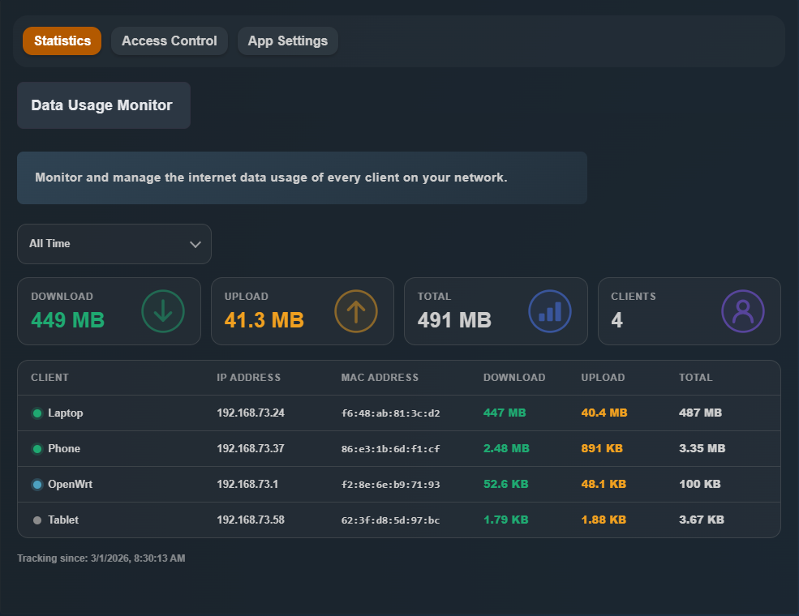
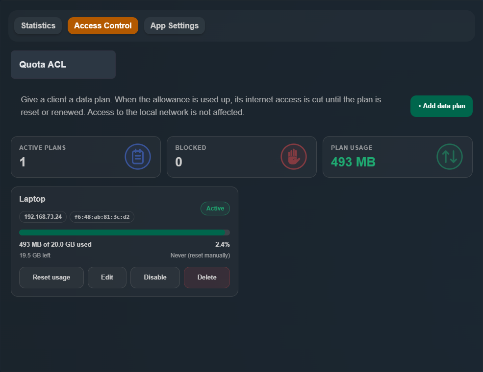
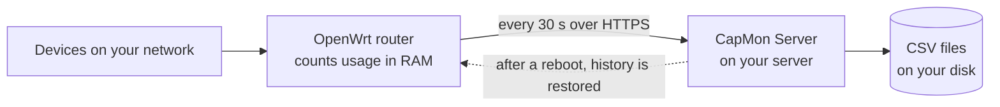

<h1 align="center">Capmon - Internet Usage Monitor</h1>

<p align="center">
  Per-client internet usage monitoring and data plans for OpenWrt
</p>

<p align="center">
  
    
  
</p>

<p align="center">
  <a href="#how-it-works">Structure</a> -
  <a href="#connecting-the-router-to-the-server">Configuration</a> -
  <a href="#3-router--quota-manager">Installation</a>
</p>

## Overview

CapMon is a small system made of two main parts that work together :

| Part | Where it runs | What it does |
| --- | --- | --- |
| **Quota Manager** | Your OpenWrt router | Counts the download and upload of every device on your network, lets you give a device a data plan, and cuts its internet access when the plan is used up. |
| **CapMon Database Server** | Any machine on your network that stays on, such as a home server | Receives the router's data and stores it as simple CSV files. |
| **Desktop App** (optional) | Windows (`.exe`), or any system with Python | A graphical window to browse the stored data, so you do not have to open the router's LuCI page every time you want to check usage. |

A router keeps its usage counters in RAM to protect the flash memory, which means the numbers disappear on every reboot or power cut. CapMon Server solves this : the router sends its data to your server every few seconds, and after a reboot the router gets its history back automatically.

The desktop app is only a viewer with a few extras. The python server does all the work on its own.

### Features

- Download, upload and total usage for every client, for All Time, Today, Yesterday, Last Week and Last Month
- Data plans per device (daily, weekly, monthly or manual renewal) with automatic blocking when the allowance runs out
- Encrypted connection (HTTPS) with a certificate pin, so the router only trusts your server
- Automatic recovery : if the server or the network goes down, the router keeps counting and sends everything when the server is back
- Optional pairing with a single router, so another router cannot write into your data
- Backup and restore from the router web page (`.tar.gz`)
- The server runs anywhere Python 3.10+ runs : Windows, Linux and macOS
- Desktop app (optional) : a live "Synced" status and a tray notification when a plan is running low or used up.

## Screenshots

<table>
  <tr>
    <td></td>
    <td></td>
  </tr>
</table>

## How it works



1. The router counts the traffic of each device and keeps the numbers in RAM.
2. Every 30 seconds the router sends a full snapshot to your server. A safety timer repeats this every 5 minutes in case anything stops.
3. The server checks the data and replaces the previous CSV file of that router with the new one.
4. When the router starts again, it asks the server for the saved data and merges it with what it has counted since boot.

## Project structure

```
capmon-server-monitor/
├── capmon/                      Server : HTTP(S) receiver, validation, storage, TLS
├── capmon_gui/                  Optional desktop app (PySide6)
├── capmon_server.py             Command line server
├── capmon_server_monitor.py     Desktop app entry point
├── requirements.txt             Server requirements
├── requirements-gui.txt         Desktop app requirements
└── run_capmon_server_monitor.bat   Windows launcher for the desktop app

luci-app-capmon/                 OpenWrt package (router side)
```

## How data is stored

### On the router

| What | Where | Survives reboot |
| --- | --- | --- |
| Usage counters | RAM (`/var/run/capmon`) | No, restored from your server |
| Data plans and settings | Router configuration (`/etc/config/capmon`) | Yes |
| Access token | `/etc/capmon/token` | Yes |

### On the server

Everything is created next to the application (the project folder when you run it from Python, or the folder of the `.exe`) :

| File | Purpose |
| --- | --- |
| `data/<router>.csv` | The latest data of each router. One plain CSV file per router, easy to open in Excel |
| `data/<router>.csv.bak` | An automatic backup of that file, refreshed once per hour |
| `config.json` | Server settings. It keeps only a hash of the token, never the token itself |
| `admin_token.txt` | The access token, so the desktop app can show it in App Settings |
| `certs/` | The self-signed TLS certificate and key of your server |
| `notified.json` | Remembers which plan warnings were already shown by the desktop app |

Files are written safely : each save goes to a temporary file first and then replaces the old one, so a power cut cannot leave a half-written file.

On Windows, if the application folder is not writable (for example inside `Program Files`), CapMon uses `%LOCALAPPDATA%\CapMon` instead.

### 1. Server : CapMon Server

You need Python 3.10 or newer on a machine that stays on and can be reached by the router.

When the server starts, it provides the three values that you need for the router :

- **Server Address**, for example `https://192.168.1.50:8765`
- **Token**
- **Certificate Pin**

See [Command line options](#command-line-options) for the other settings.

> **Firewall :** allow TCP port `8765` for your local network on the server, or the router will not be able to connect.
>
> **Tip :** give your server a fixed IP address (or a DHCP reservation on the router).

### 2. Desktop app (optional)

The desktop app is for anyone who prefers a graphical window to see usage and plans, without opening the router's LuCI page each time.

The desktop app includes the server and starts it automatically, so you do not need to run `capmon_server.py` as well. It shows the data stored on the machine it runs on. Run either the command line server or the desktop app on the same port, not both at once.

When the window opens, go to **App Settings**. You will see the same three values that you need for the router : **Server Address**, **Token** and **Certificate Pin**.

> **Windows Firewall :** allow the app on private networks when Windows asks, or open TCP port `8765` manually.

The minimize button sends the app to the system tray, so it keeps receiving data in the background. The close button quits the app.

### 3. Router : Quota Manager

Connect to your router over SSH and run :

```sh
wget -qO /tmp/capmon-installer.sh https://raw.githubusercontent.com/fullband7/openwrt-capmon/main/luci-app-capmon/installer.sh && sh /tmp/capmon-installer.sh; rm -f /tmp/capmon-installer.sh
```

The installer does everything for you :

- Detects your OpenWrt version and picks the right package (`.apk` or `.ipk`)
- Adds the CapMon public signing key to your router (`/etc/apk/keys/` on 25.12, `/etc/opkg/keys/` on 24.10). The key is built into `installer.sh`
- Downloads the latest release and verifies its signature with that key before installing (on 24.10 it also downloads the `.ipk.sig` file)
- Installs the package

## Connecting the router to the server

1. In the router web page open **Services -> Quota Manager -> App Settings**.
2. In the **Database Server** box, turn the server **Enabled**.
3. Fill in the three values you copied from the server :
   - **Server Address** : paste the address, for example `https://192.168.1.50:8765`
   - **Access Token** : paste the token
   - **Certificate Pin** : paste the pin (`sha256//...=`)
   - **Router Name (Optional)** : a short name such as `home`. If you leave it empty, the router hostname is used
4. Click **Save Changes**.

Within a few seconds the **Data Sync** box on the router shows *Synced with the data server*. If you use the desktop app, its badge also turns green with **Synced**, and your router appears in the Statistics and Access Control tabs.

> [!WARNING]
> **Turn off hardware flow offloading :** Hardware flow offloading sends established connections straight through the network chip, so the router's connection tracking does not see all of their packets. CapMon counts usage from connection tracking, so with offloading on the usage numbers can come out lower than the real traffic.
>
>
> To turn it off in the router web page, open **Network -> Firewall -> General Settings**, Select **None**, then click **Save & Apply**. Or run this over SSH :
>
> ```sh
> uci set firewall.@defaults[0].flow_offloading_hw='0'
> uci commit firewall
> /etc/init.d/firewall restart
> ```
>

### Changing the router or resetting credentials

In the desktop app, press **Reset Credentials** in App Settings and confirm. The app generates a new token and certificate. Enter the new values on the router. This also lets a different router pair with the server.

With the command line server, start it once with `--reset-token` to create a new token and clear the paired router, then enter the new token on the router.

### One router at a time

By default the server pairs with the first router that sends valid data. Any other router, or the same router name coming from a different IP address, is blocked. The desktop app shows a warning in App Settings and a tray notification when this happens. To pair a new router, use **Reset Credentials** in the desktop app, or start the command line server with `--reset-pairing`.

If you want to collect several routers in one server, start the command line server with `--allow-multiple-routers`. Each router needs its own **Router Name**, and a drop-down appears in the desktop app to switch between them.

## Command line options

These options are for `capmon_server.py` :

```bash
python capmon_server.py --port 8765
```

| Option | Description |
| --- | --- |
| `--port` | Port to listen on (default `8765`) |
| `--data-dir` | Folder for the CSV files |
| `--token` | Use your own token (16 to 128 letters, digits, dots, dashes, underscores) |
| `--reset-token` | Create a new token and clear the paired router |
| `--reset-pairing` | Clear the paired router only |
| `--allow-multiple-routers` | Accept more than one router |
| `--no-tls` | Plain HTTP, for local tests only. The router page asks for an `https://` address |

## Security

- The router and the server talk over TLS 1.2 or newer, and the router checks the certificate pin
- The access token is stored hashed in `config.json`
- Repeated wrong tokens from one address are temporarily blocked
- Every incoming file is strictly validated before it is saved
- In the desktop app, the token and pin are hidden by default, the clipboard is cleared after 30 seconds, and the window is excluded from screen capture

## Status

CapMon is a personal project and has not been tested on every router model and architecture, so bugs are possible. Issues and pull requests are welcome.
